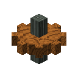
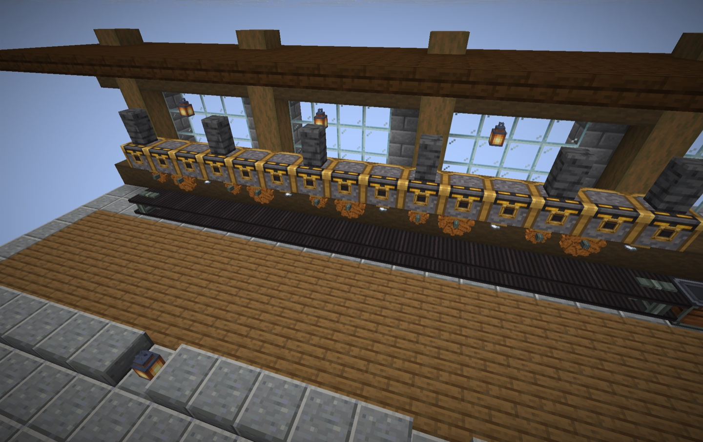
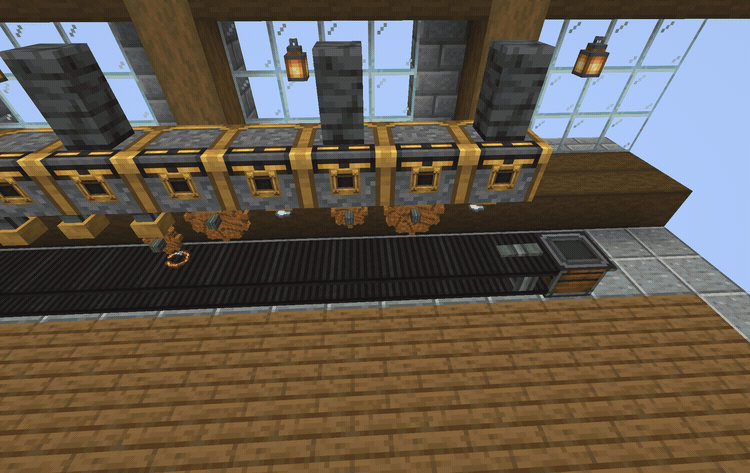
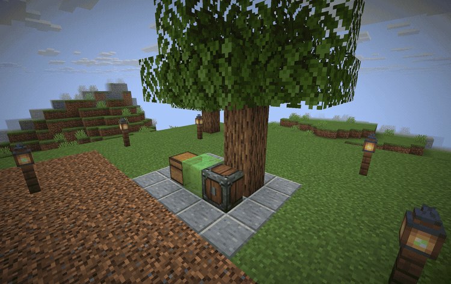

# Create for Horizon

Build small factories with gears, water wheels, belts and presses. Create for Horizon is an experimental Rust port of [Create](https://github.com/Creators-of-Create/Create), maintained by [Delete228](https://github.com/Delete228).

## What you can build

- Drive a machine with a hand crank, water wheel or Creative Motor. Route power through shafts, cogs, gearboxes, clutches and encased chain drives. Redstone controls the adjustable chain gearshift.
- Move items on basic belts and depots. Press sheets, mill ingredients and use fans to wash, smoke, haunt or blast items.
- Mix recipes in a Basin, heat it with a Blaze Burner or mine a block with a stationary Mechanical Drill. Engineer’s Goggles show speed and stress. Apply a copper ingot to stripped wood to make Copper Casing.

Use Mechanical Crafters for linked recipes or put Deployers over a belt for
sequenced assembly. Bearings, pistons, Gantry Carriages and Rope Pulleys can
move small farms with mounted chests and portable storage interfaces.
[Feature roadmap](docs/roadmap.md)

| Precision Mechanism assembly | Bearing-mounted tree farm |
| --- | --- |
|  |  |

Captured in Horizon 26.3 with the built-in models and textures.
[Assembly close-up](docs/screenshots/precision-assembly.jpg) · [Tree farm](docs/screenshots/tree-farm.jpg) · [Windmill and workshop](docs/screenshots/mill-and-workshop.jpg)

## Install

1. Create a Horizon instance for Minecraft 26.3.
2. Open **Mods → Add from GitHub** and enter `https://github.com/Delete228/create-horizon/tree/main`.
3. Build the native mod, then start the instance.

The **0.9.0** source build pins official Horizon commit `4e5296d`. Nightly
`fdc87ae` predates the stateful block-entity and state-dependent light changes.
The Horizon registry has its own published version.
[Installation guide](docs/installation.md) · [Registry listing](https://playhorizon.dev/mods/create)

## Original models and textures

The mod includes its own models and pixel textures. **For Create's original models and textures, you need the original Create 6.0.10 JAR for Minecraft 1.21.1 (NeoForge).** Put one copy in the instance's `horizon-mods/create-resources/` folder and restart Horizon. The mod reads the resources locally. [Download the supported JAR](https://modrinth.com/mod/create/version/UjX6dr61) · [Resource setup](docs/assets.md)

## Development

[Build and test](docs/development.md) · [Compatibility](docs/compatibility.md) · [Transmission review](docs/reviews/transmission.md) · [0.8 review world](docs/reviews/0.8-test-world.md) · [Contraption review](docs/reviews/0.8-contraption-world.md)

The port's code is MIT licensed. Create's code is credited to the Creators of Create. The original art and audio remain under their authors' terms. [License](LICENSE) · [Third-party notices](THIRD_PARTY_NOTICES.md)
